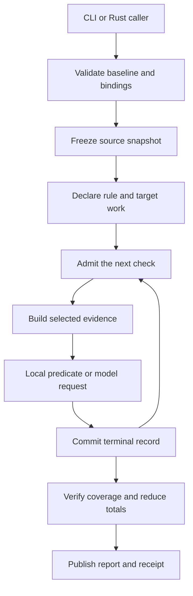
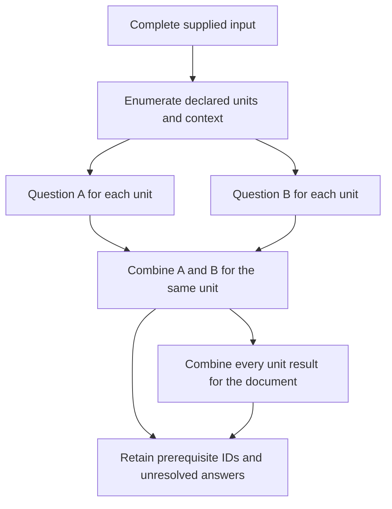
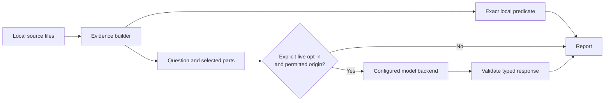

# Architecture

AudiToad separates the subject of an audit from the machinery that executes it. A baseline
supplies questions and result policies. Adapters supply evidence. One scan construction handles
the selected work, whether its evidence is Python, prose, inventory facts or Rust source.

The loop follows a frozen manifest. Scope declarations enumerate all eligible units before
execution. Declared dependencies run earlier in the same sequence; a combination reads their
committed answers. The scanner does not generate questions or change scope after seeing scores.

## Input and evidence

`ValidatedBaseline` rejects unsupported schemas, duplicate keys, unknown fields and uninstalled
bindings. Baseline aliases resolve to installed adapters and evaluators. A baseline cannot
introduce executable adapter code or enable an arbitrary network endpoint.

`Snapshot` freezes identified targets. Raw bytes form one target. An inventory supplies typed
records. Scoped text/JSON sources enumerate every sentence, paragraph, record or complete input requested
by the baseline. An evidence bundle pins UTF-8 files and PNG byte inputs and
selects subject and supporting spans/regions. Path confinement rejects links, traversal and alternate
path spellings that could escape the selected root.

A bundle can retain its existing packet checks while a scoped question enumerates every
sentence or paragraph of a complete subject file. Expanded units retain packet identity and
source byte ranges. A document summary reads only that packet's children. Unicode segmentation
supplies sentence boundaries; canonical `Sequential` and `Budget` instances own preparation
progress and aggregate target/evidence allowances.

Source identity and selected evidence identity are separate. A file can stay the same while a
question selects different parts. Reports retain both identities, the baseline digest and the
evaluator identity. Evidence builders choose the bytes; evaluators inspect those bytes.

The neutral evaluator protocol uses the existing synchronous HTTP issue boundary for models
or conventional helper services. A PNG part retains the original bytes and declared region;
the engine reads dimension headers without decompressing pixels. Helper fields are linked
through committed prerequisite records. Experimental derivation follows that graph through
local checks and gates, preserving suggested results without granting terminal clearance.

## Execution ownership

The scanner uses the published `automation-structures` crate directly. Its application binding
connects these owners in one process:

| Owner | Responsibility in a scan |
|---|---|
| `ResourceRegistry` | Registered numeric slots for full target and work identities |
| `RelationshipGraph` | Declared prerequisite edges and, in separate instances, admitted links between source records |
| `Sequential` | Scan, source preparation/verification, suite, score-input and model-slot progression |
| `Budget` | Separate cumulative allowances for checks, evidence, provider calls and prepared inputs |
| `FederatedBudget` | Shared scan/model capacity, delegated pools and canonical per-model permission ceilings |
| `ActuationPass` | Allocation and acknowledgment for provider and publication effects |
| `AuditSink` | Scan, suite and configured model-slot terminal continuity |
| `Reduction` | Scan/suite outcomes, model combinations and labelled scoring totals |

The [construction walkthrough](automation-structures.md) follows the actual calls and explains
what remains the application's responsibility. An owner instance does not replace full identity
checks, source hashing, transport validation or filesystem behavior.

Dependency edges do not create another scheduler. Profiles expand their prerequisite selection
over the graph; the existing sequential carrier executes the resulting baseline order. Local
combination maps canonical reductions of resolved and unresolved child decisions to the declared
truth table. Its default requires every child to resolve; a baseline can explicitly allow a
decisive witness for an existential or universal question. All children still execute and their
unresolved counts remain visible. A child from a different unit cannot satisfy a unit-level parent. All scoped inputs
are tied to the baseline/profile that requested them. Every source file is hashed again before
the first check: a target whose file changed after the snapshot records an error, and targets
that do not use it are unaffected. Each file is read once, however many targets use it. The
files are hashed a third time before the report is returned; a change during the scan refuses
the whole report. Whole-input context and evidence ceilings apply before any provider call.

A `collection/1` source freezes complete files through the same confined read binding as
evidence bundles. Each scope names its subject input and any supporting inputs. Scalar key
comparisons supply candidate correspondences; `RelationshipGraph::add_edge` admits matching
peers, and `edges()` determines the evidence projection. `edge_count()` checks its completeness.
Preparation progress and candidate comparisons are bounded by canonical Sequential and Budget
instances. Missing keys or inputs become evidence errors. Unit-level answer dependencies match
both input identity and unit ordinal; a shared ordinal in two files does not establish a link.

## Evaluation and trust boundaries

Multi-model roles use a scoped canonical `Sequential` over every configured member slot.
For `first_resolved`, the sequence carries the resolved cut: later slots are recorded as skipped
and make no provider call. `AuditSink` accounts for selected and skipped slots. The combined
observation retains this trace under `role_execution`, while `members` contains attempted
answers. The same scan/model budgets and effect binding govern each selected call.

The same scan can mix exact predicates and model questions. JSON equality checks address a
value in the evidence frame. A YARA check can scan raw bytes or select one decoded string with
`json_string_pointer`. This selection is part of the declared predicate; the full frame remains
in the report. Missing fields stay unresolved. Exact terminal answers enter the existing
dependency map alongside model suggestions, without an extra execution path.

Local YARA, JSON and Markdown predicates produce typed observations. Markdown parsing,
vocabulary matching and sentence/word counts are content calculations under the same scan owners; they do not maintain
another executor or scan-result total. A model backend receives a serialized question
and its evidence and returns a typed yes/no probability or a closed choice. AudiToad checks the
response identity, shape and numeric ranges before applying the rule's thresholds.
Choice responses also require the declared option set, a normalized distribution and a selected
maximum; their confidence stays separate from the yes/no probability. It does not request a prose
explanation or generated location from this adapter.

An optional `state_projection` selects named values from the complete evidence frame before
request serialization. This is a declared content mapping, shared by both model question types.
A scoped canonical `Budget` bounds the selected field copies; the complete request is also
checked against the scan, question and evaluator-role size limits. Missing pointers refuse preparation. The
report retains the full frame and hashes the actual request, so its local evidence can contain
more information than the provider received.

Provider correctness is outside the local scanner's authority. A high probability is not a
proof. Semantic observations remain `not_evaluated`; transport errors remain errors. Preparation
makes no provider call, and expected labels and earlier scores are excluded from the request.

## Completion and publication

Scoring classifies retained decisions against external labels and passes one-hot values through
the scanner's shared `Reduction` binding. Correct, wrong, unresolved, per-model and policy totals
come from canonical owners; label matching and rate formulas are domain content. The CLI and
Rust `score_files` entry prepare report, labels and optional reference through scoped
`Sequential` and a cumulative byte `Budget`. A refused input never produces a partial score.

Reuse source reports have their own finite preparation sequence and combined byte allowance.
After preparation their indexes are immutable lookups for original exchange bytes, with exact
identity and hash checks. They introduce no retry queue, provider runtime or recovery ledger.

An audit file binds named scans, evaluator files and external labels in [audit.rs](../src/audit.rs).
Its preflight checks all destinations against the suite's inputs, fixtures, credentials and
labels, then freezes input identities. Each run rechecks those identities before scanning.
The file cannot grant live consent. Labels are read for scoring and cannot overlap any run's
evidence files.

Separate scoped `Sequential` instances own finite preflight and run progress. A
`ResourceRegistry` owns run ordinals, an `AuditSink` accounts for every terminal run, and
`Reduction` computes exit counts. Each scan retains its own owners and limits. An unresolved or
failed run remains in the suite report while later runs proceed; a scoring error retains the
published scan receipt. Scores from different tasks remain separate.

Every declared rule/target pair receives a terminal record, including inapplicable and exhausted
work. The scanner checks manifest coverage, record order, sink continuity and reduced totals
before returning an outcome. Budget refusal cannot silently shorten the declared audit.

Report publication checks input overlap, writes and syncs a temporary file in the destination
directory, and persists it to the requested path. An allocated effect seat records the binding's
acknowledgment. The returned receipt contains the report hash.

This is a finite, serial, single-process construction. It has no automatic retry, durable resume,
parallel provider runtime or cross-owner crash transaction. A crash between an external effect
and local recording can leave an unknown result. OS replacement and durability behavior remain
properties of the filesystem binding and platform.
