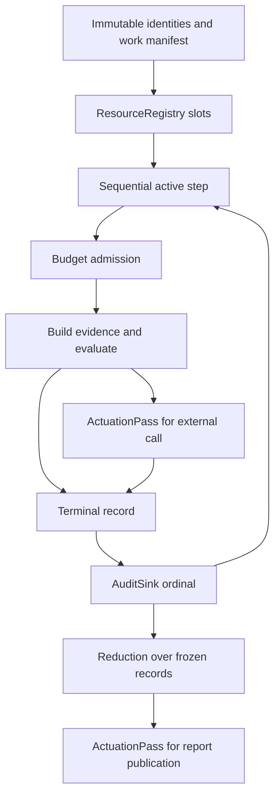

# Building AudiToad with Automation Structures

AudiToad uses the same audit engine for formal methods research, software checks, security
records and writing. This walkthrough shows how that engine is built by composing the
[Automation Structures in the Rust crate](https://github.com/brian-c-moore/automation-structures),
using the method described in the [research](https://github.com/brian-c-moore/automation-structures-research).

The scanner needs to execute a declared audit without losing checks, exceeding allowances or
reporting success after a required operation refuses. Its questions can change across domains;
those execution obligations remain.

This walkthrough follows the dependency pinned by [Cargo.toml](../Cargo.toml) and
[Cargo.lock](../Cargo.lock), and the actual calls in [scan.rs](../src/scan.rs). AudiToad uses the
published crate directly; it does not copy its owner implementations. The application connects
several owners in one serial process.

## Begin with the work

A scan freezes a baseline and its targets, declares the selected rule/target pairs, and executes
each pair under limits. It retains one terminal record for every pair. It then verifies coverage,
counts the results and publishes a report. A missing answer must remain distinguishable from a
passing answer.

After removing audit-specific terms, the obligations are identity, ordered progress, resource
admission, effect accounting, trace continuity and reduction over completed data. These map to
existing crate owners:

| Required behavior | Canonical owner and actions | Application content |
|---|---|---|
| Resolve every live work slot to its declared identity | `ResourceRegistry::insert`, `get` | Full string IDs and the immutable ordinal mapping |
| Advance one admitted step at a time | `Sequential::begin_step`, `completed`, `complete_step`, `is_done` | Which check occupies each manifest position |
| Refuse work beyond a cumulative allowance | `Budget::try_allocate`, `allocated` | Check units, evidence bytes and provider-call costs |
| Share capacity across independently limited models | `FederatedBudget::try_delegate`, `try_allocate`, `master_allocated`, `pool_allocated`; scoped `Budget` permission | Model ceilings, pool identities and actual charges |
| Allocate and acknowledge each effect | `ActuationPass::allocate`, `allocation`, `actuate`, `effect`, `finish` | HTTP calls, file publication and their full identities |
| Preserve terminal ordinal continuity | `AuditSink::try_record`, `record`, `len`, `validate` | Typed report records and evidence bytes |
| Compute totals from completed data | `Reduction::new`, `process_next`, `is_complete`, `result` | One-hot result classifications |
| Retain question prerequisite edges | `RelationshipGraph::add_edge`, `contains`, `edges` | Rule references, source and unit correspondence, required declaration order |
| Retain requirement coverage links | `RelationshipGraph::add_edge`, `contains`, `edges`; per-requirement counts through `Reduction` | Requirement IDs and revisions, profile scope and the status table |

## Connect the owners

This diagram is ordering, not a claim of a multi-owner transaction. The application binding
checks correspondence between owners at each boundary. The crate provides no named composition
for this entire scanner in the pinned release.

Scan-wide call and byte allowances use the published `FederatedBudget` composition. Each model
has a pool and separate canonical `Budget` permissions limiting how much delegation it can
receive. The application binds those existing actions; it maintains no resource balances.
This is the finite serial binding, with correspondence checks between owners.

## Identity and progress

`register` checks complete IDs for emptiness and duplicates, assigns ordinals and inserts those
ordinals into `ResourceRegistry`. It does not truncate a string hash into an identity. Before a
step begins, `scan_bound` checks that the target and work registry slots still match the manifest.

`Sequential::completed()` selects the next manifest entry. A successful `begin_step()` and
the active-step witness admit that work. After its terminal record is retained,
`complete_step(state.ordinal())` advances progress. There is no separate mutable work queue or
second progress counter deciding what executes next.

An empty manifest is handled before constructing `Sequential`, whose profile requires work.
No synthetic step is reported for an empty audit.

Model-role fallback reuses `Sequential` over the configured member slots inside the admitted
check. Its carried value records whether `first_resolved` has resolved. Later slots still
complete as skipped, without a provider call. A scoped `AuditSink` retains their ordinals,
and `role_execution` holds the selected/skipped identities. The binding checks complete slot
coverage and reduces selected flags against the attempted-answer count. It has no independent
fallback cursor, cut latch or provider executor. Each selected slot enters the same `ask_model`.

## Reuse the construction for scope and dependencies

The [scope binding](../src/scoped.rs) parses a complete text, JSON or JSON Lines input into
immutable units. Parsing determines content and locations. `Budget` admits the complete target
set and retained frames; `Sequential` owns preparation progress. The binding checks that each
completed step produced its declared target. A source with no units produces an unresolved
empty-selection target so that a requested check cannot disappear.

Sentence scope uses the pinned Unicode segmenter for content boundaries. Bundle scope reuses
this preparation for each packet's complete subject file. Separate canonical `Budget` instances
bound the combined original and expanded targets and frames; `Sequential` owns packet progress.
Packet identity couples each document summary to its own units. Existing unscoped checks keep
their original evidence bytes. No second sentence scheduler or answer accumulator is introduced.

The [baseline validator](../src/baseline.rs) inserts prerequisite edges through the published
`RelationshipGraph` composition. It requires earlier declarations, refusing cycles and forward
references. Profile selection reads that graph to include prerequisites; it does not introduce
another execution carrier. The scanner's existing `Sequential` executes the fixed order.

For explicitly selected bundle packets, a parent reads only prerequisite records for the same
registered target. For example, the Python baseline combines returned-list identity and retained
contents for one function. Packet scopes cannot depend on automatic scopes. The same graph,
committed records and reduction serve both bindings; there is no separate packet executor.

A combined check selects matching committed answer records and retains their IDs and evidence
hashes. Same-unit combinations cannot borrow an answer from another record or paragraph. Separate
`Reduction` instances calculate pass, fail and unresolved totals; the declared Boolean rule is
domain content applied to those totals. The application supplies the correspondence checks
between the graph, immutable manifest and committed records. This adds no atomic cross-owner
transaction or proof of the baseline author's logical implication.

The baseline's `resolution` policy maps those same reduced totals to a suggestion. The default
requires all children to resolve. With `decisive`, a failure settles `any_fail`, and a pass
settles `all_fail`, even when other children remain unresolved. No second aggregate is computed
and no remaining work is skipped. The recorded unresolved count concerns direct children;
nested children's own records retain their further coverage gaps. Experimental combinations
cannot turn the overall scan into a clear result.

## Separate allowances, shared implementation

Inventory preparation in [source.rs](../src/source.rs) advances through a scoped `Sequential`.
Separate target and frame-byte budgets admit each complete serialized item; completed ordinals
must correspond to retained targets and target allocation. An empty inventory remains zero-work
data, and a refusal cannot return a truncated snapshot. Source verification uses another finite
sequence over distinct declared dependency paths. Each completed read produces one verification
leaf. Digest comparison, duplicate declarations and contradictory expected hashes are content
checks; incomplete verification cannot return a partial discrepancy set.

The scan constructs `Budget` for checks and distinct `FederatedBudget` instances for evidence
bytes and provider calls. Model pool identities are frozen in configuration order. Pool 0
accounts for local evidence and anonymous mocks. Charges are cumulative for the scan.

The CLI resolves omitted check and call ceilings from the same immutable manifest. Canonical
reductions total possible model calls, including all fallback members. The preparation callback
reports those bounds before provider effects. Conditional answers can reduce actual use;
helper-dependent request sizes are unknown until those answers arrive.

Evaluator declarations supply separate call and byte ceilings to canonical `Budget` instances
for each model. The shared `admit_pool` binding obtains that permission with `try_allocate`,
then calls `FederatedBudget::try_delegate` and `::try_allocate` for the actual amount. A refused
delegation returns unused model permission with `Budget::release`. No full model ceiling is
reserved up front: shared capacity 10 and model ceilings 7/7 can admit actual use 2/7.

Model permission allocation must equal its pool's delegated capacity, and every delegation must
be consumed. Shared and model usage come from the federation's master and pool observations;
the application does not recompute them. Zero bytes are an explicit no-op. A jointly refused
charge leaves both owners unchanged. Earlier admitted byte charges remain conservative,
including a response allowance when a later call admission refuses. Completed calls are never
released. Reused responses charge actual retained bytes and make no provider call.

A check is charged before evidence evaluation. Evidence and serialized request bytes are charged
before use. Before a live call, the binding reserves the complete response allowance and charges
one provider call. Refusal records unresolved work; it cannot silently remove that manifest entry.

The known-answer checks in [baseline.rs](../src/baseline.rs) use scoped `Budget` and `Sequential`
instances for their own declared allowance and progress. They run before target evaluation.
These are additional instances of the canonical owners, not another implementation.

Optional model-question state selection in [evaluator.rs](../src/evaluator.rs) uses another scoped `Budget`.
The baseline supplies field names and JSON Pointers; pointer lookup and serialization are content
operations. Each selected field's serialized size is charged with `try_allocate` before its
value is copied. Refusal stops request preparation before provider admission. The final wire-size
check still includes the question and request envelope. This allowance bounds construction of
one request and does not replace the scan's evidence or provider-call accounting.

## Bind effects to real operations

For related evidence, [collection.rs](../src/collection.rs) reuses the confined file reader and
scoped unit parser. It compares the declared JSON Pointer values as domain content, then calls
`RelationshipGraph::add_edge` for each matching peer. Evidence comes from the graph's `edges()`
projection, whose size must agree with `edge_count()`. A local list cannot override which
relationships were admitted. Separate canonical budgets bound preparation, candidate comparisons,
targets and complete frames; Sequential owns preparation progress. Missing inputs or keys refuse
the affected evidence instead of becoming a negative model answer.

Collection loading borrows one byte `Budget` through the manifest and all listed file reads.
The physical reader obtains headroom through `available()` and admits bytes through
`try_allocate`; a caller does not calculate another remaining-byte ledger. Bundle packet
preparation uses `Sequential` begin/complete actions and checks target-allocation correspondence.

`ask_model` allocates an `ActuationPass` seat for a target and checks its allocation before
calling the provider. The physical transport returns a response or error. The binding records
the actuation and finishes the pass, then validates and classifies the response.

An actuation acknowledgment does not mean the model answered correctly. Even a failed HTTP
attempt is an attempted external operation. The response decoder separately checks model and
check identity, probability range and response shape. The report keeps errors and experimental
status rather than treating the effect record as semantic success.

`publish_bound` checks input overlap before scanning. After the scan, `publish_bytes_bound`
allocates a publication seat, writes and syncs a temporary file, persists it, records the effect and returns
the report hash. `ActuationPass` does not perform HTTP or filesystem operations itself; those
are physical bindings whose results the application must check.

## Commit and count

Before appending a terminal record, the binding requires both the typed record count and
`AuditSink::len()` to match the active ordinal. It records that ordinal through
`try_record`, retains the typed record, and verifies the recorded operation before completing
the step. At the end it checks sink validity, full manifest coverage and record identity/order.

The sink retains an in-memory ordinal trace. It does not store or authenticate the complete
report bytes. AudiToad owns those typed bytes and computes their SHA-256 separately.

Only after records are frozen does the application classify each record into a zero-or-one
value for each status. `Reduction` owns each total. The binding drives `process_next()` until
`is_complete()` and reads `result()`. It then uses another reduction to compare the sum of
status totals with the manifest length. A caller-maintained running total would create a second
authority over the same aggregate, so the scanner does not use one.

[score.rs](../src/score.rs) reuses that same `reduce` binding. It freezes classified labelled
decisions and derives confusion-matrix, correct/wrong/unresolved, per-model, coverage and policy
totals through canonical `Reduction` instances. Label matching, one-hot classification, policy
truth tables and rate division are application content. Missing labelled records remain
unresolved leaves rather than disappearing from the denominator.

The CLI's `score_files` entry uses scoped `Sequential` to prepare the fixed report, labels and
optional reference. A `Budget` owns their combined input bytes. The ordinary confined reader
enforces the remaining allowance; scoring begins only after every input is admitted. Byte-oriented
`score` and `compare_scores` share the same reductions without performing I/O.

[replay.rs](../src/replay.rs) also reuses finite preparation for multiple reuse reports.
`Sequential::completed()` selects the next declared report, and `Budget` admits its bytes
against the combined allowance. Immutable exchange indexes retain original bytes and full
identity after preparation; they are not execution queues or mutable cache authorities.
Repeated paths, broken custody or exhausted allowance refuse the whole preparation.

## What the construction establishes

The audit-file binding in [audit.rs](../src/audit.rs) reuses this construction for a finite suite.
Its immutable declarations supply names, paths and scan settings. `ResourceRegistry::insert/get`
binds each unique run name to an ordinal; separate scoped `Sequential` instances govern preflight
and execution. Each run invokes the existing scanner synchronously. Its terminal record is
coupled to `AuditSink::try_record/record/validate` and `Sequential::complete_step`; `Reduction`
owns exit-code totals and their correspondence with the declared run count. Invalid preflight
refuses the suite before scans. Later scan or scoring failures receive terminal records and do
not remove subsequent runs. Per-run scan limits reset; there is no shared suite cost budget.

Preflight freezes source identities and checks all outputs against all inputs, fixtures,
credentials and labels. Each run rechecks its identity before execution. Suite publication
reuses `publish_bytes_bound`. This binds ordinary files to the existing serial scan without a
second provider executor, retry policy or copied owner. The suite has no crash resume, atomic
snapshot across files, or transaction spanning its individual report publications.

The binding makes each owner's refusal relevant to the reported outcome. Tests in
[scan.rs](../src/scan.rs) bypass required budget, progress, trace, reduction and effect coupling
and require the scan or publication to refuse clear completion. Tests in
[canonical_contracts.rs](../tests/canonical_contracts.rs) exercise the consumed checked API.

The tests cover a bounded finite scanner. They do not turn the crate's contracts into an
end-to-end formal proof of AudiToad. Full identity comparison, file confinement, evidence
selection, HTTP correctness and platform behavior remain explicit application obligations.
There is no durable recovery protocol or atomic commit across all owners.

## Apply the method elsewhere

Describe the work and failure cases first. Remove domain names while retaining the obligations.
Find the shared owners and compositions whose actions decide success and refusal. Supply domain
data and physical bindings around them, then test the correspondence between each action and
the visible result.

For AudiToad, a shipping policy, a prose checklist and a disk inventory change the evidence and
questions. They reuse the same scan construction. A new concurrent or resumable execution
profile would require a new construction review; it cannot be added as a private worker loop
or recovery ledger beside these owners.
