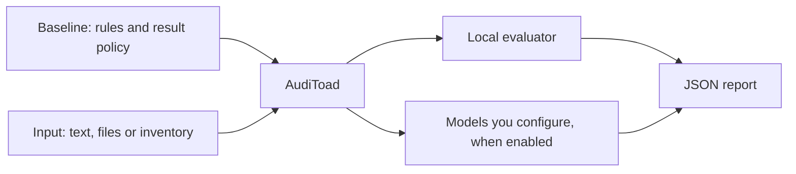

# User guide

AudiToad answers checks about evidence you supply. An audit consists of a baseline, an input
and a report. The baseline says what to check; the input supplies the evidence; the report
records what ran, what it observed and what remains unresolved.



## Install

From a source checkout:

```console
cargo install --path . --locked
auditoad --version
auditoad scan --help
```

Building the executable requires Rust and a native toolchain. Using it does not require writing
Rust. There is no Python package or Python-specific project layout to configure. See the
[build guide](build.md) for prerequisites and the [examples](../examples/README.md) to start.

## Choose your input

| Subject | Supply | Adapter |
|---|---|---|
| Every sentence, paragraph or a complete text | One UTF-8 file; the baseline declares unit and context | `text/1` |
| Every record or a complete JSON value | A JSON file; record scope requires a root array | `json/1` |
| Structured event logs | One JSON value per nonblank line | `json-lines/1` |
| Several related logs or documents | A collection naming whole files; the baseline declares their relationships | `collection/1` |
| Writing, requirements, policies, source code or configuration | UTF-8 files and a bundle selecting their relevant parts | `evidence-bundle/1` |
| Images and screenshot regions | Pinned PNG/JPEG files in a bundle; whole images can use native Jev preview, regions require a compatible helper | `evidence-bundle/1` |
| Assets, services, hosts or other recorded entities | An inventory JSON file with IDs, kinds and facts | `inventory-json/1` |
| A file checked for byte patterns | That file and a YARA baseline | `raw-bytes/1` |

Python, JavaScript and prose use the same text-evidence adapter. Its parts can pair a subject
with requirements, reference data, another document or related code. A bundle does not need
to describe a code repository. `--project-root` is the CLI name for the directory containing
its evidence files.

PDF, Word and audio decoding are not installed adapters. Export suitable text or facts
with a tool you trust, preserve their connection to the original material, and audit those
inputs. A report covers the supplied evidence and selected rules.

For code, optional local [syntax helpers](../examples/language-helpers/README.md) extract exact
spans in Bash, Zsh, PowerShell, Python, Rust, Verus and TLA+. A later question can consult those captures
alongside the source. They parse supplied text without executing it; they do not discover project
dependencies or establish runtime behavior. Parsing failures remain visible and unresolved.

For scoped text and JSON sources, pass the ordinary input file directly to `--input`.
No bundle or `--project-root` is needed. The baseline's scope chooses complete input, sentences, paragraphs
or records and whether each unit needs the complete input as context. See
[scope and answer dependencies](../BASELINES.md#declare-scope-instead-of-selecting-known-locations).

For collections, pass the manifest to `--input`. AudiToad reads paths relative to that manifest
unless you supply `--project-root`. The baseline selects units and matches related records by
declared keys. Missing sources stay visible in the report. See the
[related-events example](../examples/related-events/README.md) for three small questions whose
answers establish one larger observation.

## Run a local audit

The inventory example checks whether each supplied disk record declares encryption:

```console
auditoad baseline validate examples/disk-encryption/baseline.json
auditoad scan --baseline examples/disk-encryption/baseline.json --input examples/disk-encryption/inventory.json --report inventory-report.json
```

Validation checks the baseline's schema and installed bindings. At scan time, deterministic
rules also run their known-answer checks. The input contains a passing disk, a failing disk and
a disk with missing information. Open the report to see all of them.

`--profile` overrides the baseline's `default_profile`; a sole profile is selected automatically.
With several profiles and no default, choose one explicitly. `--source` overrides input-based
selection: inventory, bundle and collection schemas identify their adapters; other inputs use
JSON, JSON Lines (`.jsonl`/`.ndjson`), UTF-8 text or raw bytes. Two aliases of the same kind require
a choice. `--report` names an output whose parent exists. Bundle and collection roots default to
their manifest's directory; use `--project-root` for a different root.

## Prepare a model audit

Use preparation to inspect the evidence before submitting it:

```console
auditoad scan --baseline examples/shipping-policy/baseline.json --input examples/shipping-policy/bundle.json --report prepared.json
```

Preparation builds the request and writes it into the report. It sends nothing to a model. The
report's `usage.provider_calls` is zero, and the command exits 2 because no answer was obtained.
Each record's `evidence.bytes` and `observation.request_bytes` are objects of the form
`{"encoding":"utf-8","text":...}`, or `{"encoding":"hex","data":...}` for bytes that are not
UTF-8. The report also retains source paths and hashes.

To run the audit with a model, add `--evaluators <file> --live` with an evaluator file that
names your backend (see [Choose the models](#choose-the-models)). The baseline profile must permit
that backend's origin. Only the selected evidence and question enter the provider request;
expected labels and report history do not.

Draft baselines automatically produce experimental reports. The old `--experimental` flag
remains accepted for command compatibility, but ordinary commands do not need it.

## Run an audit file or suite

Put recurring runs in an [audit file](audit.schema.json):

```json
{
  "schema": "auditoad-audit/1",
  "report": "suite-report.json",
  "evaluators": "evaluators.json",
  "runs": [
    {"name": "writing", "baseline": "baseline.json", "input": "documents.json",
     "report": "writing-report.json", "labels": "labels.json"}
  ]
}
```

Each run requires `name`, `baseline`, `input` and `report`. Optional fields are `profile`,
`source`, `project_root`, `evaluators`, `labels`, `mock` and `replay`. Names and output destinations must be
distinct. Paths are relative to the audit file, or absolute; parent traversal and linked paths
are refused. Put shared audit declarations above their input folders. Labels are optional.

```console
auditoad run examples/audit.json
auditoad run examples/audit.json --evaluators examples/evaluators.local.json --live
```

The first command runs local checks and prepares model requests without sending them. The
supplied suite covers inventory, a code requirement, writing format and related events. Reports
are written beside the audit file. Exit code 2 reflects experimental model observations and an
unknown inventory fact. The inventory labels cover the two known facts; its missing fact stays
unlabelled and unresolved in the scan.

The suite checks paths, inputs, label declarations and output collisions before starting scans.
It freezes each run again before execution and refuses changed inputs. Runs execute serially;
a finding, unresolved answer or runtime failure is recorded and does not hide later runs.
The suite report retains each scan's receipt, outcome, usage and optional score. Exit precedence
is invalid/error-to-start (3), unresolved (2), blocking finding (1), then clear (0). A failure to
publish the suite itself returns 2. Per-run reports remain separate artifacts.

To compare arrangements, declare two runs with the same baseline, input and labels but different
evaluator files and reports. CLI `--evaluators` overrides every run; otherwise the run's file
overrides the audit-level file, followed by `AUDITOAD_EVALUATORS`. Baselines never select models.
`--live` is per invocation and cannot be stored in an audit file. Mocks cannot run with `--live`.

Scores keep wrong, unresolved and missing labels visible for each run. Per-model scores use
retained observations; simulated combination policies are labelled as simulations, not fresh
model runs. Development, calibration and untouched holdouts still require deliberate selection;
a suite does not make its labels independent or establish whole-subject coverage.

## Preparation and operator ceilings

Before a scan's first provider call, AudiToad prints target/check counts and maximum calls by
model, including every fallback member and conditional question. Actual use may be lower.
Known inapplicable pairs remain in the check count and report but do not add potential calls.
CLI check/call defaults allow the complete prepared manifest. Preparation without `--live`
does not read credentials or send requests.

Individual models can declare `max_provider_calls`, `max_evidence_bytes` and `timeout_seconds`
in the [evaluator file](evaluators.schema.json). A model's byte ceiling covers requests plus
65,536 reserved response bytes per call, across all its roles in one scan. Timeouts default to
30 seconds and accept 1 through 120. Zero call/byte ceilings refuse work; refused answers remain
unresolved. Reports include per-model reserved usage.

`--max-provider-calls`, `--max-evidence-bytes` and `--provider-timeout-seconds` override the
corresponding model settings. The first two also cap the entire scan; its byte ceiling includes
selected evidence, requests and reserved responses. Limits reset for each named run. A lower
endpoint/question request-size limit still applies.

Without an operator cumulative byte ceiling, the scan accounts for all retained evidence up to
the representable budget capacity. This is not a memory cap or an exact cost forecast. Later
evidence/request sizes can depend on helper answers and are identified as unknown in preparation.
File, target, work, fixture and individual-request safety bounds remain configurable through the
CLI. Set a cumulative byte ceiling when a run requires a fixed resource limit.

## Labels beside your inputs

An [external labels file](labels.schema.json) names a rule and whether its condition holds:

```json
{
  "schema": "auditoad-labels/1",
  "dataset": {"id":"policy-controls","revision":"1","split":"development"},
  "labels": [
    {"rule": "POLICY-1", "packet": "example-case", "violation": true},
    {"rule": "EVENT-1", "input": "events", "line": 3, "violation": false}
  ]
}
```

Use exactly one selector: `target` with the report's exact ID, `packet` with a bundle packet
name, or `input` and a one-based original JSON Lines line number. Collection input names come
from the manifest; standalone inputs use the source name in their report. Ambiguous selectors
are refused. Missing labelled targets remain in the denominator as unresolved. Labels are used
after scanning and never sent to models.

Optional `dataset` metadata records an `id`, `revision` and `split` (`development`, `calibration`
or `holdout`), plus optional `notes`. Scores and suite scores retain it beside the full label-file
hash. Omitted metadata stays unspecified. A split is your declaration: AudiToad does not partition
data or certify that nobody has inspected a holdout. After examining its failures, use those cases
as development evidence and select independent cases for the next holdout.

```console
auditoad score --report examples/inventory-report.json --labels examples/disk-encryption/labels.json
```

Every score includes a `cases` row for each label, with its resolved target, decision,
correct/wrong/unresolved classification, terminal result and reason. A missing record remains
an unresolved case. These rows also appear in audit-file suite scores.

Each tally reports `resolved_accuracy` (correct / resolved decisions) alongside `decision_coverage`
(resolved / labelled cases in that tally). With no resolved decisions, accuracy is null and
coverage is zero. Read both: 100% accuracy at 10% coverage means most cases remain unanswered.
Overall/rule denominators include missing labels; per-model tallies cover recorded observations,
as their scope states. The existing true/false-positive rates and scorecard remain separate.

For a paired comparison, use the same labels and source snapshot:

```console
auditoad score --report candidate.json --compare reference.json --labels labels.json
```

The comparison retains both score summaries and pairs each labelled case, including regressions,
missing records and unchanged decisions. `decision_changed` flags a changed answer;
`same_recorded_request` and `same_recorded_evidence` compare recorded SHA-256 identities when
both are present. A null comparison means comparable hashes are unavailable. Derived parent
evidence can change because it contains fresh child IDs even when child requests match.
Recorded mock markers remain visible; this command never calls a provider.

Different source bindings, input hashes or snapshot identities are refused. Collection snapshots
include the frozen referenced files, so an unchanged manifest alone is insufficient. Changed
scope selection may also change the snapshot and require separate scores. Matching snapshots
do not make changed questions equivalent: keep label meanings fixed and review the two baseline
identities. Exit 0 means both reports account for all labels, not that either audit passed;
missing labels produce exit 2 and an invalid comparison produces exit 3.

## Choose the models

A baseline asks questions; it never names the model that answers them. A rule's evaluator is
`{"kind":"model","contract":"yes-no/1"}`, `"choice/1"` or `"extract/1"`, and may name a `role`
such as `judge` or `helper`. Rules without a role use the role `default`. The evaluator file you
pass with `--evaluators` names your models and says how each role uses them:

```json
{
  "$schema": "../docs/evaluators.schema.json",
  "schema": "auditoad-evaluators/1",
  "evaluators": {
    "jev":   {"backend": "typesafe-jev", "model": "jev-1.13.0",
              "endpoint": "https://api.typesafe.ai/v1/systemone", "key": {"env": "TYPESAFE_API_KEY"}},
    "local": {"backend": "openai-compatible", "model": "local",
              "endpoint": "http://127.0.0.1:8080/v1/chat/completions"}
  },
  "roles": {
    "default": {"use": "jev"},
    "judge":   {"ask": ["jev", "local"], "combine": "first_resolved"},
    "helper":  {"use": "local"}
  }
}
```

Without `roles`, each model name is also a role, so a file with one model named `default`
answers every rule that names no role. With `roles`, every role a selected rule names must be
declared. A role takes one of three forms:

| Role | Behavior |
|---|---|
| `{"use": "jev"}` | One model answers |
| `{"ask": ["jev", "local"], "combine": "..."}` | Several models answer the same question, and their answers are combined |
| `{"off": true}` | Questions with this role are not asked; their records say why |

| `combine` | Asks | Suggests |
|---|---|---|
| `first_resolved` | In order, stopping at the first pass or fail answer | That answer; review if none |
| `agreement` | Every model | The shared answer when every model passes or every model fails; review otherwise |
| `any_fail` | Every model | Fail when any model fails; pass when all pass; review otherwise |
| `all_fail` | Every model | Fail when all fail; pass when any passes; review otherwise |

A combined record keeps attempted models' complete observations under `members`, so you can see
who said what. `role_execution` records every configured slot as selected or skipped; fallback
slots after the first resolved answer make no call. How models should cooperate depends on the models and on the kind of audit, so treat
the roles as an experiment: run the same baseline with different evaluator files, then compare
the reports with [`auditoad score`](../BASELINES.md#qualify-a-question-on-different-cases). One
run with `agreement`, `any_fail` or `all_fail` asks every model, which lets the score report each
model alone and every combination policy from that single run. Switching a helper role `off`
runs the same baseline without the helper.

Replay an original live report through the ordinary scanner without new HTTP requests:

```sh
auditoad scan --baseline baseline.json --input input.json \
  --evaluators evaluators.json --replay original-report.json --report replayed-report.json
```

An audit-file run can similarly set `"replay": "original-report.json"`. Replay requires an
evaluator file and cannot combine with `--live` or `--mock`. No credentials are read. It verifies
the original source binding, input and snapshot, then each reused exchange's model alias,
backend, endpoint, decoding policy, complete evidence and exact request bytes. Retained byte
hashes must match. Changed or missing exchanges stay unresolved; replay never falls back to HTTP.
The installed decoder reads the original response bytes again, including refusal of invalid
answers. Helpers, fallback roles and combined models use the normal question graph.

This lets you test thresholds or combination policies when they leave the individual requests
and evidence unchanged. Changed questions, projections or selected source need new inference.
Older reports whose request identities depend on a scan UUID may not match. A replay cannot be
used as the original live report for another replay; retain the original instead. The input
report is bounded by `--max-input-bytes` and protected against output overwrites.

Each reused observation carries `replay` provenance with the original report and response hashes.
Its `mock: false` describes the retained live exchange; it does not mean a new call was made.
`usage.provider_calls` counts admitted local replay attempts, and `provider_elapsed_ms` measures
local replay time. Retained token usage describes the original response, not new consumption.
Scoring preserves replay provenance. Hashes check consistency of the supplied unsigned report;
they do not authenticate its publisher or establish model accuracy.

Reuse earlier answers so that a revised baseline asks only what changed:

```sh
auditoad run audit.json --live --reuse earlier-report.json
```

An exchange is reused when its evaluator identity (name, backend, model, endpoint and decoding
policy), complete evidence and exact request bytes equal an original live exchange in a named
report. Rule names, targets and source files need not match, so an unchanged question on unchanged
evidence is answered from the retained bytes, while any changed question, projection, consulted
answer or evidence is asked live with `--live`, or only prepared without it. Name several
reports with repeated `--reuse`; the first retained answer for an identity wins. An audit file
can declare `"reuse": [...]` for every run, a run's own `reuse` overrides it, and an empty list
forces fresh answers. `--reuse` on the command line overrides both, and `--no-reuse` forces
fresh answers everywhere. Nothing is reused unless a source is named. `--max-input-bytes`
bounds the combined bytes of all reuse source reports for a run. If they exceed it, preparation
refuses the collection without making a provider call. Raise the allowance explicitly for
larger retained reports.

A reused observation carries `reuse` provenance with the source report and response hashes and
makes no provider call: `usage.reused_exchanges` counts it, apart from `usage.provider_calls`.
Only original live exchanges can be reused. A mixed report contributes its new live replies;
earlier reused replies are skipped, so name their original reports too. A report containing
only reused replies is refused, as are mocks and replays. Reuse cannot combine with `--replay`
or `--mock`. When repeated runs are meant to
measure how stable fresh answers are, run them without reuse.

A `--mock` script instead supplies synthetic answers. Each reply may name an evaluator-file
`model`; with `--evaluators` and without `--live`, AudiToad applies the file's roles to those replies.
These observations remain marked as mocks. Consulted answers exclude transport metadata at
every combined-model level while the original records retain it.

| Backend | Answers | Serves |
|---|---|---|
| `typesafe-jev` | `yes-no/1` and `choice/1` | TypeSafe's question API |
| `openai-compatible` | `yes-no/1`, `choice/1` with up to 26 options, and `extract/1` | Chat-completion servers that return token log-probabilities: llama.cpp, Ollama, vLLM and hosted APIs |
| `auditoad-compatible` | `yes-no/1`, `choice/1` and `extract/1` | Models or conventional helpers implementing the [neutral evaluator protocol](#neutral-evaluator-protocol) |

An evaluator can declare `"capabilities": ["extract/1"]`, for example for a helper that only
extracts fields. Omitted capabilities retain the backend's installed support. A declaration
cannot add support to a backend that lacks it. Unsupported selected tasks refuse before calls;
capability policy is retained in evaluator identities and changes invalidate exchange reuse.
Backend compatibility does not establish accuracy or calibration. Tune and measure each
baseline/model/helper arrangement on matched labelled evidence.
For a neutral visual helper, include `image/png` alongside its task capabilities. See
[screenshot evidence](../BASELINES.md#supply-screenshot-evidence) for byte custody, region
selection and the image contract's limits. The `typesafe-jev` binding supports explicit
whole-image PNG/JPEG preview requests and Box locations with image opt-in; see the
[Jev image example](../examples/jev-images/README.md). It refuses partial regions.
The `openai-compatible` binding can consume selected derived text, but does not dispatch images.
The [helper evaluator example](../examples/evaluators.helpers.json) uses a local text helper
for `extract/1` and Jev for judgments. It targets Qwen2.5-Coder-7B-Instruct Q4_K_M
through llama.cpp on `127.0.0.1:8080`. The helper has no image capability. This is an initial
example configuration; its task accuracy must be measured separately from server compatibility.

Use the publisher's [GGUF model](https://huggingface.co/Qwen/Qwen2.5-Coder-7B-Instruct-GGUF)
with its embedded chat template and a compatible llama.cpp server. For example, with the file
already downloaded:

```console
llama-server --model <model.gguf> --alias qwen2.5-coder-7b-instruct-q4_k_m --jinja --host 127.0.0.1 --port 8080 --threads 2 --threads-batch 2 --parallel 1 --ctx-size 24576
```

The server runs separately from AudiToad. The evaluator file limits each request to 60 seconds
and 4,096 output tokens. [`evaluators.local.json`](../examples/evaluators.local.json) checks
only the local helper, with the judgment role switched off. To use Ollama or another server, change the
model identifier and endpoint in the evaluator file; no baseline or scanner change is needed.

`key` is `{"env": "NAME"}` or `{"file": "path"}`, relative to the evaluator file; omit it for a
keyless local server. Keys are read only with `--live`, and only for models a role uses.
Endpoints must use HTTPS, except on `127.0.0.1`, `localhost` or `[::1]`. For an
OpenAI-compatible backend, AudiToad asks for a one-word answer and reads the probability of
`true` against `false` from the first token's log-probabilities; a server that returns no
log-probabilities produces an error, not a guess. For a choice, it labels the options A, B, C and
so on, and reads the probability of each label from the first token. The option probabilities
are normalized over the labels, and confidence is the share of the first token's listed
probability that fell on a label. Extraction requires a server that supports strict JSON Schema
response formats. AudiToad supplies the declared field names and types as that schema, then
checks the returned types and every quote against the evidence. Unsupported schemas or invalid
quotes produce an error. Set `max_output_tokens` (default 2048) to bound the generated answer.

Every compatible-chat response must name its producing `model`, as specified by the
[chat-completion response contract](https://developers.openai.com/api/reference/cli/resources/chat/subresources/completions/methods/retrieve).
AudiToad requires that identifier to equal the configured `model`. If a server resolves a
request alias to a different identifier, set `"response_model": "exact-returned-model-r1"`
in that evaluator. Missing or different identifiers produce an error for every task; changing
the expected identifier changes evaluator identity and invalidates exchange reuse. This is
a checked peer declaration, not independent verification of the server's implementation.

### Neutral evaluator protocol

Use `auditoad-compatible` to connect a model or conventional helper that implements AudiToad's
protocol. In the evaluator file, `model` identifies the exact model or helper implementation
revision, such as `ocr-service-r3`. Keep that revision pinned when reproducing an experiment.
The service runs independently; AudiToad makes one bounded synchronous request per admitted
task and retains the exchanged bytes. Preparation, role combinations, limits, egress, typed
extraction, consultation, scoring, replay and reuse follow the ordinary product path.

The JSON request holds `schema: "auditoad-evaluator-request/1"`, the configured `model`,
the projected `state` and exactly one `questions` entry keyed by its content-derived identity.
That entry has `type` (`yes-no`, `choice` or `extract`), `instructions`, and either `criteria`
or declared extraction `fields`. A service returns:

```json
{
  "schema": "auditoad-evaluator-response/1",
  "model": "ocr-service-r3",
  "answers": {
    "<exact question identity from the request>": {
      "type": "extract",
      "fields": {"text": "The extracted text"}
    }
  }
}
```

Use exactly the declared fields and types. For `yes-no`, the answer instead has `type` and
numeric `probability` between zero and one. For `choice`, it has `type`, `choice`, `confidence`
and `probabilities`: a complete distribution over exactly the declared options, summing to one
within 0.000001, with the selected choice having maximum probability. No normalization occurs.
The envelope and answer accept only these fields. Mismatched versions, identities, answer sets,
types, extra fields or nonverbatim quotations refuse. A service's claimed identity is not
authenticated software provenance, and a supplied probability is not a calibrated guarantee.
An extraction can use `string` when it derives new text; `quote` must occur in supplied text.

A model may set `max_request_bytes` to the largest request its endpoint accepts. A request is
also bounded by `--max-request-bytes` and the question's own limit; the smallest applies, and a
larger request is refused, never truncated.

The baseline profile's `allowed_egress` still decides where data may go. List each HTTPS origin,
or `loopback` for a model on this machine. A live scan refuses to start if any model a selected
rule's role uses is not permitted. Without `--live`, `--replay` or `--mock`, the file only shapes
the prepared requests, so you can inspect exactly what each model would receive.

Probabilities from different models are not calibrated against each other, so validate each
question's thresholds for the models that answer it. Reports record the role and each model's
backend, model and endpoint behind every answer.

The baseline can further select named fields through
[`state_projection`](../BASELINES.md#choose-which-fields-the-model-receives). The baseline author
chooses these fields, and AudiToad applies the same selection to each target. The report keeps
the full prepared evidence locally; `request_bytes` shows the exact question and state sent
to the model. A missing selected field leaves the check unresolved without a provider call,
unless the field is declared optional.

A backend returns either a yes/no probability or a named choice with probabilities and confidence.
AudiToad applies the rule's thresholds and answer mappings to suggest pass, failure or review.
This model workflow is implemented. The report retains the answer and its `suggested_result`,
which can be scored against labels and reused or replayed under the recorded identities.

This release deliberately withholds accepted final audit decisions from model judgments.
Semantic rules remain experimental with terminal `not_evaluated`, and the scan exits 2 even
when the model answered successfully. That status alone does not establish whether a request
was sent; inspect the observation, reason and provider-call accounting. Additional accuracy
measurements do not enable semantic admission in this release; that path requires a product change.

## Read the report

| Result | Meaning |
|---|---|
| `pass` | The evaluator and rule policy produced a passing result |
| `fail` | The evaluator and rule policy produced a failing result |
| `review` | The result policy requires review |
| `notapplicable` | The target is outside the rule's declared applicability |
| `not_evaluated` | Evaluation or admission remains unresolved |
| `error` | Evidence preparation, evaluation or another required operation failed |

The report includes `counts`, `usage`, `records`, the source snapshot, the baseline identity
and the overall `outcome`. Each record identifies its rule and target, retains evidence and
provides an observation or reason. `source.metadata` stores shared source metadata once;
records refer to it by hash.

An empty inventory or selection with only `notapplicable` records remains `unresolved` and
exits 2. The report and CLI explain this through `outcome_reason`: no applicable checks ran.
The report retains the exact empty or inapplicable scope instead of inventing missing targets.
Evaluating a nonempty supplied inventory still does not independently prove that it contains
every real asset or required record.

When the baseline declares [requirements](../BASELINES.md#declare-the-requirements), the report
lists each one with a `status`, the selected rules that check it and their result counts. A
requirement that is `missing`, `unasked`, `stale`, `unsupported` or `unresolved` makes the
outcome `unresolved` and is named in `outcome_reason`; the CLI prints one status per requirement.

Each scan and check has its own audit identity. Model observations also record a `question_id`
derived from the question and the selected state. This stable ID is the question key sent to
Jev; the random scan identity does not enter the provider request. Repeating the same question,
selected state and evaluator configuration produces the same request bytes. Inspect
`request_sha256` when comparing repetitions. Equal requests do not guarantee equal model answers,
and changed helper answers can change the state of a later question.

The CLI prints a summary and the report's SHA-256 after publication. It prints semantic
observations as they are committed. A report can contain both failures and unresolved work.

Dependency checks can use a decisive answer policy. A positive event can then answer an
"any event" question while other events remain uncertain. Inspect the combination's
`unresolved` count and its child records; a resolved suggestion does not mean complete coverage.
The overall experimental scan still exits 2. See the
[dependency policies](../BASELINES.md#declare-scope-instead-of-selecting-known-locations).

| Exit code | Meaning |
|---|---|
| 0 | Complete scan with no profile-blocking result |
| 1 | Complete scan with a blocking finding |
| 2 | Unresolved or experimental work, a blocked requirement, an incomplete scan, or report-publication failure |
| 3 | Invalid inputs or baseline |

Code 2 takes precedence over 1. Check it explicitly in automation. A draft model suggestion
must not be treated as a passing CI result just because it is below the failure threshold.

## Use the CLI from Python

Python can invoke the installed executable and read its JSON report:

```python
import json
import subprocess
from pathlib import Path

report_path = Path("inventory-report.json")
report_path.unlink(missing_ok=True)
result = subprocess.run([
    "auditoad", "scan",
    "--baseline", "examples/disk-encryption/baseline.json",
    "--profile", "inventory", "--source", "inventory",
    "--input", "examples/disk-encryption/inventory.json",
    "--report", "inventory-report.json",
], check=False)

if result.returncode not in (0, 1, 2):
    raise RuntimeError("AudiToad rejected the request")
if not report_path.is_file():
    raise RuntimeError("AudiToad did not publish a report")
report = json.loads(report_path.read_text(encoding="utf-8"))
for record in report["records"]:
    print(record["rule"]["id"], record["target"]["id"], record["result"])
```

The example removes its earlier generated report before invoking the command. Use a new report
destination when you need to retain earlier runs. Otherwise a failed invocation could leave an old file at the same path. The CLI's
exit code and publication message belong to the current invocation.

## Limits and common failures

Use `--max-provider-calls` and `--provider-timeout-seconds` to bound a live audit. Calls are
serial. The scanner has no automatic retry. A timeout or rejected response remains visible.

`--max-input-bytes` bounds reads; `--max-evidence-bytes` covers selected evidence, requests and
reserved responses. `--max-request-bytes` bounds each serialized model request. Exceeding a limit
does not silently truncate the source. Unevaluated work stays in the report.

For `auditoad score`, `--max-input-bytes` is a cumulative allowance for the report, labels and
optional `--compare` reference (default 16 MiB). Exceeding it refuses scoring with exit code 3
and no partial score. For inventory preparation, `--max-evidence-bytes` must also admit every
complete serialized item; an exhausted preparation allowance refuses the whole snapshot.

`--max-baseline-bytes` bounds the scan's baseline file (default 2 MiB). Declare a larger bound
when a large explicit question graph needs it; schema and dependency validation still apply.

Each live call reserves 65,536 response bytes in the cumulative evidence budget, in addition
to selected evidence and serialized request bytes. For fixed independent model checks,
prepare the scan first without `--live`: its reported evidence usage plus 65,536 times the planned
call count bounds the required live allowance. For example, 2,091 calls reserve about 131 MiB
before evidence and requests. Dependent answers, consultations and multi-model roles can add
evidence or calls; include those costs. A byte allowance does not guarantee that a request fits
a model's token limit.

TypeSafe Choice responses must sum to 1 within 0.000001 by default. If the provider rounds
its probabilities, an operator may explicitly set `choice_probability_sum_tolerance` to
`0.01` in that evaluator's declaration. This changes the recorded evaluator identity and
acceptance policy. AudiToad retains the raw values; it does not normalize them or relax
option identity, probability range, or selected-option checks.

For a hash mismatch, confirm the file revision and update the bundle's hash intentionally.
For a missing role, check both the bundle's parts and the baseline's `required_roles`.
For `notapplicable`, compare the target kind with the rule's applicability. For unresolved
model output, inspect its reason and suggestion before changing the question or evidence.
