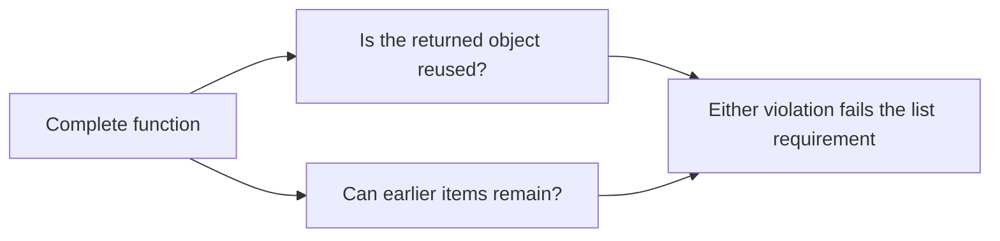

# Audit Python order-processing code

This example checks ten Python functions against five written requirements. Five functions
contain policy violations; five provide comparison cases. The source has no explanatory comments
or answer labels. AudiToad reads the selected functions as text and does not run them.

[The results note](RESULTS.md) records 13 matching policy results out of 14, with one review, for
version 1 of this baseline. Version 2 added Python truthiness context. Version 3 selects
functions locally by name, adds source-quote helpers and uses the fixed 0.1/0.9 decision
thresholds. Version 4 requires a selected function before dispatch; an import or optional helper
context cannot satisfy that prerequisite. A retained version 3 Qwen helper-only check returned
ten valid source quotations with zero errors. Earlier Cisco development runs exposed a refused invented quotation and a wrong
shipping suggestion; see the results note. Neither observation qualifies policy accuracy.
Current Jev measurements remain pending. A separate historical test on new
implementations resolved 21 of 24 policy results correctly,
with two reviews and one wrong answer. The public example alone does not establish accuracy
on unfamiliar Python code.

| File | Why it is here |
|---|---|
| `orders.py` | The code being audited |
| `policy.md` | Shipping, discount, decoding, normalization and list-lifetime requirements |
| `baseline.json` | Function selectors, five quote helpers, eight policy questions and one combination |
| `bundle.json` | Complete source and policy files, target names and file hashes |

## Run it

Run from this directory with `auditoad` installed:

```console
auditoad baseline validate baseline.json
auditoad scan --baseline baseline.json --profile all --source evidence --input bundle.json --project-root . --report prepared.json
```

Preparation makes no network requests. It records 38 applicable checks: ten local syntax
observations, ten quote-helper records, 16 policy questions and two locally combined list results.
Four list prerequisite answers are diagnostic details,
leaving 14 policy results. The baseline also
reports pairs outside each rule's selected kind as `notapplicable`. The command exits 2 because
no provider answer has been obtained.

To obtain live observations with [`evaluators.helpers.json`](../evaluators.helpers.json),
which uses a configured local text helper and sends policy questions to Jev using
`TYPESAFE_API_KEY`, run the command below. Pass
[`evaluators.local.json`](../evaluators.local.json) to check only the local helper with judgment
questions switched off, or supply your own evaluator file.

```console
auditoad scan --baseline baseline.json --profile all --source evidence --input bundle.json --project-root . --evaluators ../evaluators.helpers.json --live --max-provider-calls 26 --provider-timeout-seconds 60 --report report.json
```

Local `syntax/1` queries select each complete function by its exact name before any provider
request. The two decoding selectors also capture `import json`. Shared questions consult their
two named selectors: only the selector for the current target supplies code. The projected
`code_a` or `code_b` field contains those captures; the other is null.
Both helpers and judgment questions require at least one of those function fields to be non-null.
If the named function is absent or parsing fails, the check remains unresolved and makes no
provider request. Imports and optional helper quotes do not satisfy this requirement.
Projections select the `function` and `imports` capture labels rather than capture positions.
Reordering captures cannot substitute an import for a function. Multiple captures with the
same requested label, including duplicate named functions or several separately captured
imports, refuse dispatch and need a reviewed selection update. Source dependencies still
need review after a change.
Quote helpers receive only selected code and return excerpts describing the relevant comparison,
guard, error handling, normalization or list lifetime. Policy questions receive the complete
selected function, policy where needed and optional helper quotes. A helper quote cannot replace
the function or make a policy decision. Switching the helper role off still leaves the function
available to each policy question.
Expected answers in this README are
excluded. The model returns a probability per question; AudiToad prints its suggested result and
retains the request, response and evidence in `report.json`. Experimental results exit 2.

## Read the baseline

`PY-SHIPPING` asks whether shipping is charged exactly at the policy's free-shipping threshold.
`criteria_true` defines a violation, and `criteria_false` defines agreement.
`applicability` limits that rule to the two shipping functions. The other rules follow the
same pattern for distinct requirements. They do not ask for a general code-quality verdict.

The list requirement has two parts. Copying a list after adding an item can return a new object
that still contains old items. Clearing and returning a shared list can remove old items while
still returning the same object. `PY-LIST` combines the two answers for the same function:



The combination makes no model call. Its `answers/1` check lists both prerequisite IDs and
uses `any_fail`. A definite violation settles this result; an uncertain prerequisite prevents
a passing result. Current questions use fixed 0.1/0.9 thresholds; [the results note](RESULTS.md)
preserves the earlier calibrated design.

The bundle pins complete files; the baseline selects functions by name. No line ranges need
maintenance. AudiToad does not infer Python dependency closure. After a source change, review
the named function and its dependencies, then update the file hash. Syntax captures establish
source locations and text, not execution or policy compliance.

## Expected observations

These answers were recorded before the live run. They are author-reviewed expectations.

| Rule | Function with a violation | Comparison function | What distinguishes them |
|---|---|---|---|
| `PY-SHIPPING` | `shipping_fee` | `express_shipping_fee` | The order at exactly 5,000 cents |
| `PY-MEMBER` | `discount_rate` | `renewal_discount` | Truthiness versus the boolean `True` |
| `PY-DECODE` | `decode_order` | `decode_return` | A decoding error returned as `{}` versus an exception |
| `PY-EMAIL` | `contact_email` | `billing_email` | Retained versus removed leading whitespace |
| `PY-EMAIL-END` | `contact_email` | `billing_email` | Retained versus removed trailing whitespace |
| `PY-EMAIL-CASE` | Neither function | Both functions | Both convert uppercase letters to lowercase |
| `PY-LIST-IDENTITY` | `add_note` | `add_message` | Reused returned object versus a fresh object |
| `PY-LIST-CONTENT` | `add_note` | `add_message` | Retained contents versus independent contents |
| `PY-LIST` | `add_note` | `add_message` | The combined list-independence requirement |

Use the observed results to assess these particular questions. A correct answer on one function
does not establish that the question detects every Python defect. This example's purpose is to
make question wording, selected evidence and known comparison cases visible together.
