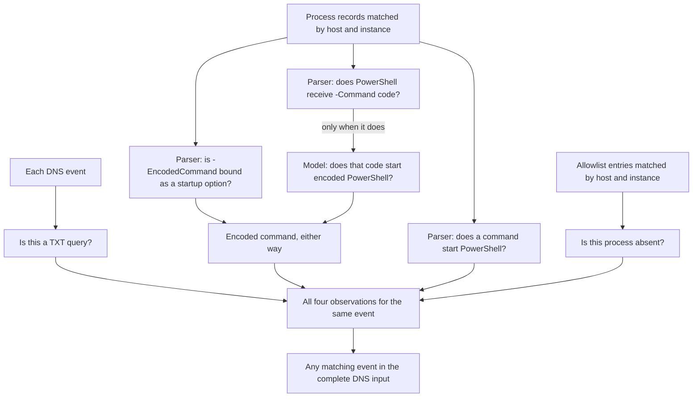

# Connect small questions about related evidence

This example asks whether a process used an encoded PowerShell command, made a DNS TXT query,
and was absent from an allowlist. Each fact is a separate check. AudiToad matches the
supporting records to each DNS event, then combines the answers about that event.

This activity can be legitimate. The example demonstrates evidence selection and question
dependencies; it does not establish that a machine was compromised. The small logs are
synthetic, and the encoded payload prints `ping`.

## Files

| File | Purpose |
|---|---|
| `dns.jsonl` | Four DNS events, one per line; all four are audited |
| `processes.json` | Process commands, including a record from another host |
| `allowlist.json` | The approved process instance |
| `inputs.json` | Names the complete files and their formats |
| `baseline.json` | A shared command-line grammar, five exact checks, one model question and three answer combinations |
| `listed-a.json`, `unlisted-txt.json` | Known-answer frames for the DNS type and allowlist checks |
| `encoded-invocation.json`, `printed-mention.json`, `script-argument.json`, `nested-code.json` | Known-answer frames for the command-line checks |

The baseline matches both host and process instance. Array position and operating-system
process IDs do not establish identity. Process records are deliberately in a different order
from DNS records. An unrelated host has a similar process identifier.



Whether PowerShell runs, and which startup options it receives, is decided by how Windows and
PowerShell parse the command line. The `command-line/1` checks compute that exactly from a
grammar declared once in the baseline: Windows PowerShell, PowerShell 7, cmd.exe and the
`start`, `call` and `conhost` launchers. PowerShell 7's option names, abbreviations and prefix
characters follow its [open-source parser](https://github.com/PowerShell/PowerShell/blob/master/src/Microsoft.PowerShell.ConsoleHost/host/msh/CommandLineParameterParser.cs);
Windows PowerShell 5.1's matching is undocumented, and the grammar assumes the same minimum
abbreviations. cmd.exe follows the quote rule in `cmd /?`.

Code passed to PowerShell with `-Command` is not command-line syntax. The parser reports it,
and only for those events does the model receive the parsed invocations and answer whether that code
starts PowerShell with an encoded command. The two answers are combined with `any_fail`: either
way of passing an encoded command counts.

## Run

From this directory, with `auditoad` installed:

```console
auditoad baseline validate baseline.json
auditoad scan --baseline baseline.json --profile all --source events --input inputs.json --report prepared.json
```

Preparation uses no network calls. Inspect its evidence and related source locations. To ask the
model, add an evaluator file with `--live`. [`evaluators.json`](../evaluators.json) sends questions
to Jev and reads `TYPESAFE_API_KEY`; pass [`evaluators.local.json`](../evaluators.local.json) or
your own evaluator file to use another model:

```console
auditoad scan --baseline baseline.json --profile all --source events --input inputs.json --evaluators ../evaluators.json --live --report report.json
```

The profile selects the final question. AudiToad automatically includes all its prerequisites:
twenty local checks, four model questions, eight event combinations and one input summary. Only
events whose PowerShell receives `-Command` code are sent to the model; the others record that the
question was not asked. DNS type uses exact string equality. Allowlist membership checks
whether the complete matched array is empty. The known-answer frames check every local
predicate before the logs are audited. Combinations do not make additional provider calls.
Semantic results remain experimental and the command exits 2.

## Expected observations

These labels are for the reader; this README is not sent to the model. A positive leaf observation
uses `fail` so the combinations can express `all_fail` and `any_fail`. For the model question this is a
`suggested_result`; for the exact checks it is a terminal result.
An individual positive premise is not by itself a security finding.

| DNS line | TXT query | Starts PowerShell | Encoded command | Outside allowlist | All four |
|---|---|---|---|---|---|
| 1 | Yes | Yes | Yes | Yes | Yes |
| 2 | Yes | Yes | Yes | No | No |
| 3 | No | Yes | Yes | Yes | No |
| 4 | Yes | Yes | No | Yes | No |

The final summary should report a matching event. Reviews or missing evidence keep the
corresponding combinations unresolved. These four authored cases establish expected behavior
for the example, not an accuracy estimate for unseen security logs.

The current baseline matches every label on these four events. The single Jev call concerns
event 4, whose PowerShell receives `-Command` code.

Earlier versions asked Jev whether each command started PowerShell and whether it passed an
encoded command. On a 32-event set of executing commands, printed text, filenames, quoting,
abbreviations and script arguments, Jev matched 41 of 64 answers, with five false positives
and eighteen reviews. It confused arguments passed to a script with PowerShell's own options.

The same labels, unchanged, measured against the current baseline on 88 authored events in six
sets:

| Set | Events | Encoded command | Wrong | Review |
|---|---|---|---|---|
| This example | 4 | 4 | 0 | 0 |
| Development | 8 | 8 | 0 | 0 |
| Transfer | 8 | 7 | 0 | 1 |
| Fresh | 12 | 11 | 0 | 1 |
| Command study | 32 | 29 | 0 | 3 |
| Parser study | 24 | 24 | 0 | 0 |

PowerShell execution, DNS type and allowlist membership matched every label. The five reviews
are PowerShell code that only prints text naming PowerShell; Jev did not resolve it. Jev
correctly identified both events whose code starts encoded PowerShell. The parser study was
written with its labels frozen before the parser ran; its first run missed the `start`, `call`
and `conhost` launchers, which were then added to the grammar, so these figures are
development evidence. All sets are authored: they test the listed command forms, not
arbitrary malware.

## Try a missing source

In `inputs.json`, replace the allowlist entry with:

```json
"allowlist": {"adapter":"json/1", "unavailable":"Allowlist export was not supplied"}
```

Prepare again. The allowlist questions now name the missing evidence, issue no provider calls,
and leave their dependent combinations unresolved. An available empty `allowlist.json`
containing `[]` means no process is listed; that is a different input from an unavailable
allowlist.

The [baseline guide](../../BASELINES.md#connect-evidence-from-different-inputs) explains how to
declare the same relationships for other records and documents.
