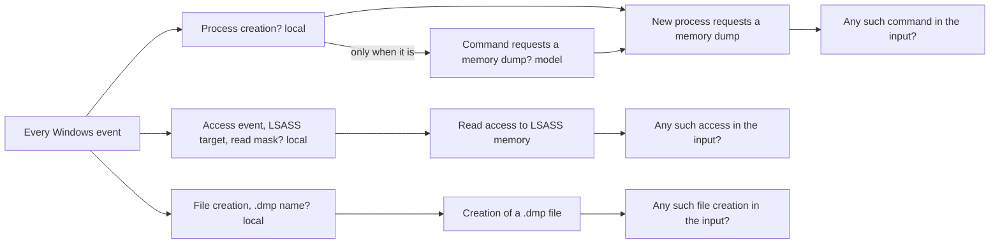

# Read memory-dump activity in Windows logs

This example audits an existing Windows event capture from Open Threat Research Forge (OTRF).
It checks each event for three activities: a newly created process that requests a memory dump,
requested or granted read access to LSASS memory, and creation of a `.dmp` file. Each activity
is the combination of smaller premises. Every premise that is an exact fact about the record is
a local check: the log channel, the event ID, a filename ending in `.dmp`, a target ending in
`\lsass.exe`, and an access mask that includes `PROCESS_VM_READ` (0x10). Only one premise needs
a model: whether a new process's command line requests a memory dump. It is asked only for
process-creation events. The capture contains 184 events from Windows Security and Sysmon.

The baseline examines every record. It contains no sample username, machine name, process ID,
timestamp, output path or expected line number. You can supply another capture in the same
JSON Lines format without changing the questions. The results below concern this capture;
other event schemas and command forms require their own validation.

| File | Purpose |
|---|---|
| `events.jsonl` | The complete, unmodified event capture, one JSON record per line |
| `inputs.json` | Names that file and its format |
| `baseline.json` | The local checks, the model question, their combinations and input summaries |
| `known-pass.json`, `known-fail-*.json` | Known-answer records for the local checks |
| `LICENSE-OTRF.txt` | The dataset's MIT license and attribution |

## Run

From this directory, with `auditoad` installed:

```console
auditoad baseline validate baseline.json
auditoad scan --baseline baseline.json --profile all --source logs --input inputs.json --report prepared.json
```

Preparation makes no network calls. Inspect its selected evidence before enabling a model. Then run the
command below. [`evaluators.json`](../evaluators.json) sends questions to Jev and reads
`TYPESAFE_API_KEY`; pass [`evaluators.local.json`](../evaluators.local.json) or your own evaluator
file to use another model:

```console
auditoad scan --baseline baseline.json --profile all --source logs --input inputs.json --evaluators ../evaluators.json --live --max-provider-calls 2 --provider-timeout-seconds 10 --report report.json
```

The run makes two requests, one for each process-creation event in this capture. Each request
contains only that event's command line. Every other premise is decided locally, and a record
that creates no process clears the dump-command check without a model question. Semantic results remain experimental, so the command exits 2.

Use `--profile commands`, `access` or `files` to run one activity and its summary. Each summary
uses `resolution: "decisive"`: one positive event establishes that the activity occurs, even
if another event remains uncertain. A negative summary requires every event to resolve negatively.
The report retains every premise's result, the model's probability, the source line and evidence
identity, including unresolved children. These suggestions do not clear the experimental scan.
The five local filename/target/access-mask checks consult unadmitted `answers/1` combinations.
Their computed pass/fail values remain suggestions with `experimental_inputs: true` and terminal
`not_evaluated`, including when a closed gate skips a check. The original eight local event
premises retain their mechanical terminal results. This preserves the derivation's admission
boundary; it does not change the exact predicates or hide their labelled decisions.



## Expected observations

These labels were reviewed before the run and are not sent to the model. Line numbers identify the
answers for a reader; they do not select the scanner's input.

| Check | Positive lines | Positive records | Other records |
|---|---|---:|---:|
| `DUMP-COMMAND` | 17, 107 | 2 | 182 |
| `LSASS-MEMORY-ACCESS` | 3, 5, 6, 9, 74, 76 | 6 | 178 |
| `DUMP-FILE` | 75 | 1 | 183 |

The two command events describe the same process through different Windows providers. They
are two observations, not two separate attacks. Access records include Windows Security
requests and Sysmon process-access events. The file-creation question is about the event type
and filename; it does not inspect the resulting file.

Always inspect positive detection and false-alarm counts separately. Most records are negative
for each individual question, even though they come from an attack simulation. An all-negative
answer would look accurate as a percentage while missing every requested signal.

## Recorded results

With version 2, a preparation run with no model finds all six LSASS read-access records and the
one `.dmp` creation from local checks alone, with no false alarms, and selects exactly the two
process-creation records that carry the dump commands. The model's two answers have not yet
been recorded.

Version 1 of this baseline asked a model all three questions about every record. Two live runs matched **485/552** and **484/552 answers (87.9% and 87.7%)**, with 67 and 68 reviews
and no wrong resolved answers. All three input summaries resolved correctly in the second run.
The table below shows the first run.
All nine positive labels were found. These counts describe one capture, with repeated observations
of the same activity; they do not estimate accuracy across Windows attacks.

| Question | Correct positive | Correct negative | Wrong | Review |
|---|---:|---:|---:|---:|
| `DUMP-COMMAND` | 2 | 176 | 0 | 6 |
| `LSASS-MEMORY-ACCESS` | 6 | 119 | 0 | 59 |
| `DUMP-FILE` | 1 | 181 | 0 | 2 |

The original run's three input summaries remained in review because the original resolution
policy required every prerequisite to resolve. The baseline now uses decisive resolution for
these existential questions. A local replay of the same 552 responses resolves all three
summaries correctly while retaining the same 67 unresolved leaf answers:

| Summary | Positive witnesses | Unresolved events retained | Suggestion |
|---|---:|---:|---|
| A dump command occurs | 2 | 6 | Fail |
| LSASS read access occurs | 6 | 59 | Fail |
| A .dmp creation occurs | 1 | 2 | Fail |

Every replayed question, criterion and evidence frame was checked against the original live
request. This validates how existing answers combine; it is not a new model-accuracy run.
The original 552 serial requests totaled 149.061 seconds of provider time. The replay made no
network calls. The version 1 observations were bound to that baseline and are no longer shipped. The scanner's
`provider_calls` counter counts mock invocations too; it is not an egress counter.

## Source and limits

Roberto Rodriguez contributed the [OTRF capture and scenario description](https://securitydatasets.com/notebooks/atomic/windows/credential_access/SDWIN-201018195009.html)
on 2020-10-18. The [original archive](https://raw.githubusercontent.com/OTRF/Security-Datasets/master/datasets/atomic/windows/credential_access/host/psh_lsass_memory_dump_comsvcs.zip)
contains the single JSON Lines file included here as `events.jsonl`. Archive SHA-256:
`0af9e920220d746432f0972be83ad057629695540aecd68c15869d190786e1ae`.
The dataset is distributed under the [OTRF MIT license](LICENSE-OTRF.txt).

The scenario maps to [ATT&CK T1003.001, LSASS Memory](https://attack.mitre.org/techniques/T1003/001/).
These checks observe parts of that activity. They do not cover every implementation of the
technique, establish credential theft, determine authorization, or correlate events merely
because they share an input file. For explicit relationships between inputs, see the separate
[related-events example](../related-events/README.md).
